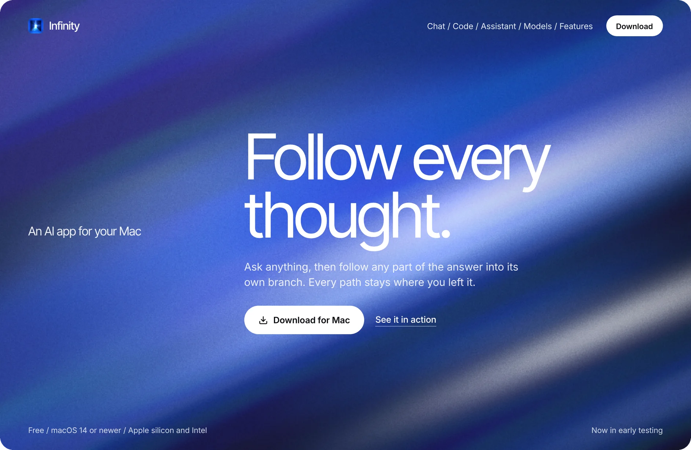
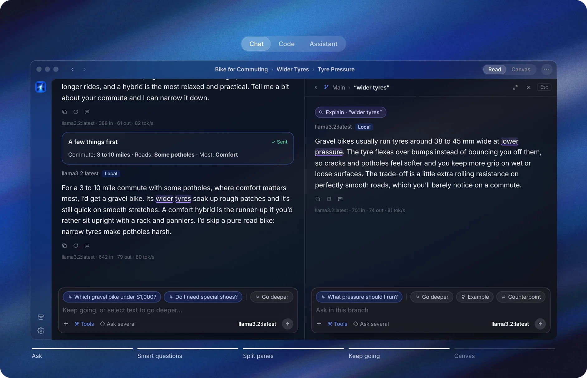
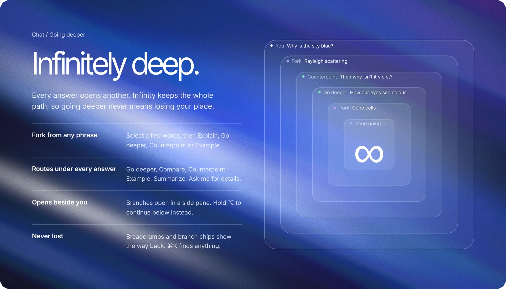
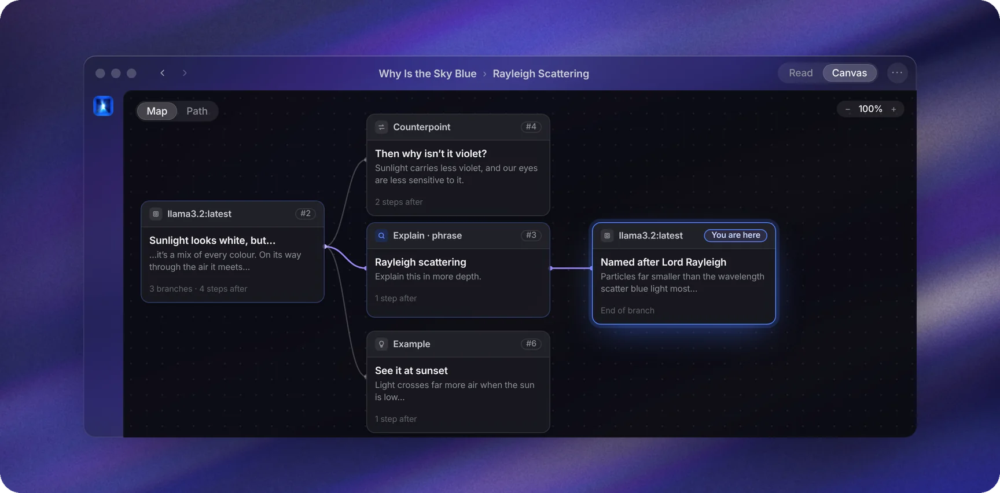
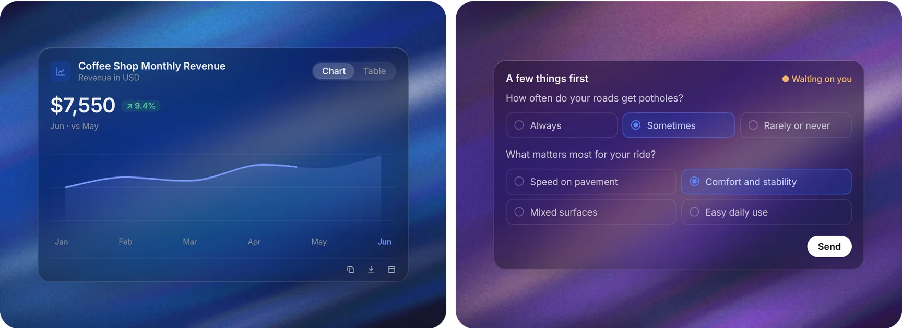
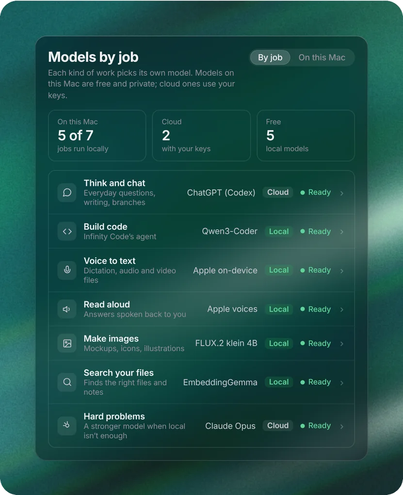
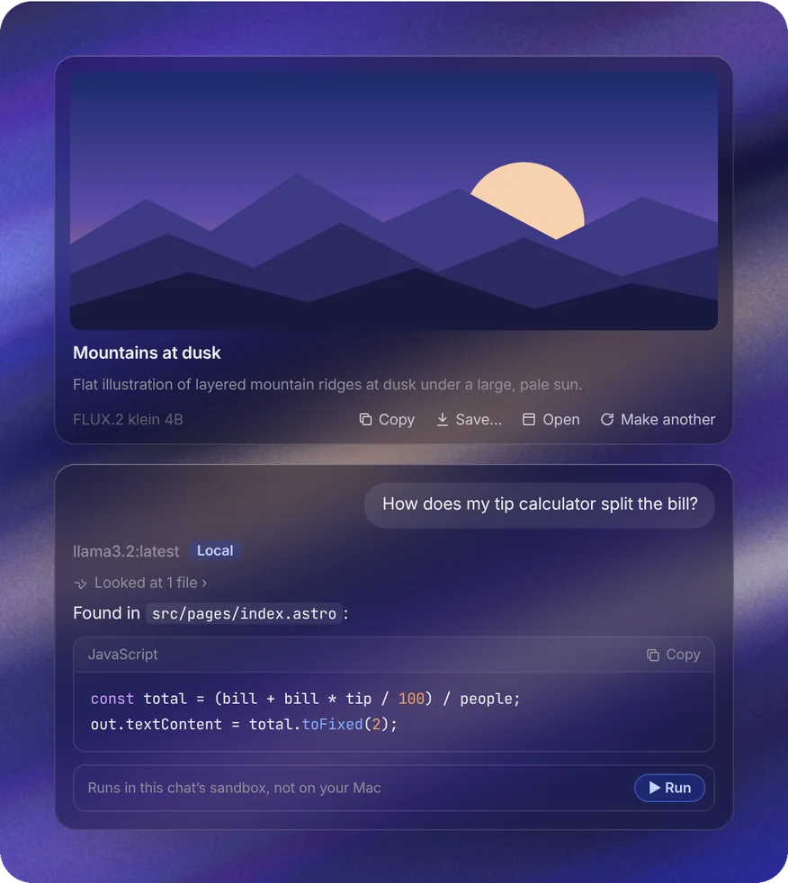
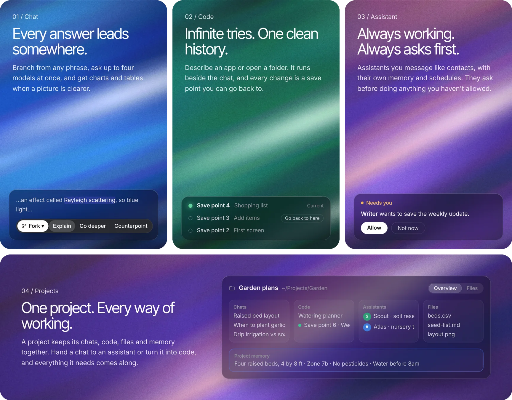
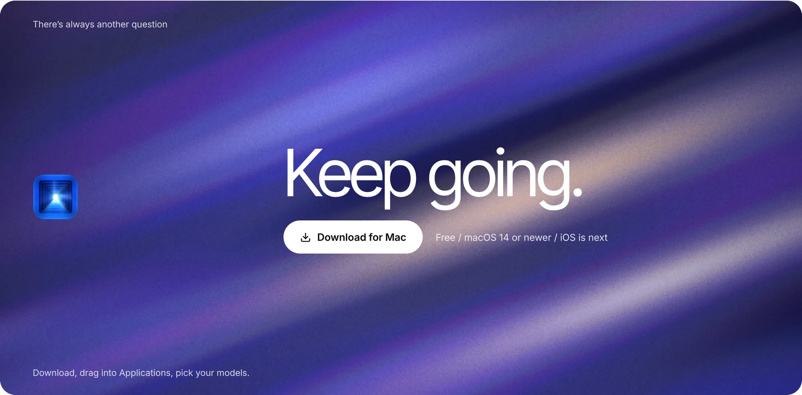

 

<a href="https://github.com/InfinityChat/mac/releases/latest"><b>⬇&nbsp; Download for Mac</b></a>
&nbsp;·&nbsp; Free &nbsp;·&nbsp; macOS 14 or newer &nbsp;·&nbsp; Apple silicon and Intel &nbsp;·&nbsp; Now in early testing

 

| ∞ | 4 | 10+ | 0 |
|:-:|:-:|:-:|:-:|
| branches from every answer | models answering at once | providers, on your Mac or in the cloud | accounts, ads or analytics in the app |

Works with OpenAI · Anthropic · Gemini · xAI · Mistral · Groq · OpenRouter · Together · Hugging Face · Ollama · LM Studio · Apple Intelligence · MLX · llama.cpp · vLLM · Jan · your ChatGPT plan · your Claude plan

 

> ### Most chats move in a single line.
> Infinity lets every answer branch, so you can follow a thought as far as it goes and still find your way back.

 

 

## Infinitely wide.

Canvas lays every branch out on one map. Restart from any card, fork it, pin it or open it beside you. Read follows a single path, like a normal chat (⌥⌘1 / ⌥⌘2).

## Answers in every shape.

When a picture is clearer than prose, Infinity draws it. When it needs to know more, it asks, and you just tap. Line, bar, donut, combo, scatter, range and timeline charts, tables, comparisons and checklists; any chart becomes a table, an image or a question.

## Every model. One window.

<table>
<tr>
<td width="52%" valign="top">

Ollama, LM Studio, MLX LM, vLLM, Apple Intelligence, OpenAI, Anthropic, Google, OpenRouter, Groq, Mistral, xAI, Hugging Face, or anything OpenAI-compatible.

- **Ask several.** Send one message to up to four models. Each answer becomes its own branch.
- **Free on your Mac.** Local models run on your machine and never send a word.
- **Or the plan you have.** Paste a key, or sign in with your ChatGPT plan through Codex.
- **Models by job.** A model each for chat, code, voice, images and search, sized for your Mac, with Hugging Face's library built in to find more.

</td>
<td width="48%" valign="top"></td>
</tr>
</table>

## Pictures, files and code.

<table>
<tr>
<td width="48%" valign="top"></td>
<td width="52%" valign="top">

- **Make images.** On your Mac with FLUX.2 or Image Playground, or in the cloud.
- **Search your folders.** Infinity finds the right file by meaning, not just by name.
- **Run code safely.** Code in an answer runs in the chat's own sandbox, not on your Mac.

</td>
</tr>
</table>

## One app. Three ways to work.

Switch with ⌘1, ⌘2 and ⌘3. Projects are shared across all three, so nothing needs explaining twice.

## And so on, and so on.

All of it is in the app today, free.

| Chat | Code | Assistant | Models and Mac |
|---|---|---|---|
| Fork from any phrase | Start from an idea, a folder or GitHub | Assistants you message like contacts | Ollama, LM Studio, MLX LM, vLLM |
| Six routes under every answer | Build, Plan first or Just ask | Own instructions, model, folder, voice | OpenAI, Anthropic, Google and more |
| Side pane or continue below | Save points with Go back to here | Memory you can read, edit and undo | Your ChatGPT plan through Codex |
| Read and Canvas views | Explain and Change this on draft copies | Groups with a lead | Models by job, and Find models on Hugging Face |
| Ask up to four models | Live preview with Point | An inbox for approvals | Images with FLUX.2 or Image Playground |
| Charts, tables and checklists | Code, Changes and Terminal | Automations on a schedule | Search your folders by meaning |
| Tap-to-answer questions | Claude Code, Codex, OpenCode, Pi | Your day, a morning brief | Code runs in a sandbox |
| Projects, archive, temporary chats | Secrets with Test and Live values | Calls, out loud | Native SwiftUI, light and dark |
| ⌘K to jump anywhere | Put it live on Vercel, Netlify and more | Teams shared as one file | Updates itself, signed by Apple |

## Private by default.

| | |
|---|---|
| **No account** | Nothing to sign up for, and no analytics in the app. |
| **On your Mac** | Chats, settings and the file index stay here. |
| **In your Keychain** | API keys are stored by macOS, with your passwords. |
| **Straight to the source** | Messages go directly to the provider you chose, with your key. |

Read the [privacy note](PRIVACY.md).

 

## Install

1. [Download the latest `Infinity-x.y.z.dmg`](https://github.com/InfinityChat/mac/releases/latest).
2. Open it and drag **Infinity** into **Applications**.
3. Open Infinity and pick your models: free ones on your Mac, your own API keys, or both.

Infinity is signed and notarized by Apple, and keeps itself up to date: new versions download in the background and install when you quit, or straight away from the blue button at the bottom of the sidebar. Check any time with **Infinity ▸ Check for Updates…**, or turn daily checks off in **Settings ▸ General ▸ Updates**.

To wipe chats and settings and see first-run setup again, use **Settings ▸ Developer ▸ Reset Infinity**. Downloaded local models stay, and you can choose to keep your API keys.

## Feedback

Infinity is in early testing. Use **Help ▸ Send Feedback…** in the app, or email [support@ampdynamic.com](mailto:support@ampdynamic.com). Found a bug? [Open an issue](https://github.com/InfinityChat/mac/issues).

 

<a href="https://infinitychat.app">infinitychat.app</a> · Made by Amp Dynamic · Infinity and its icon are trademarks of Amp Dynamic.

