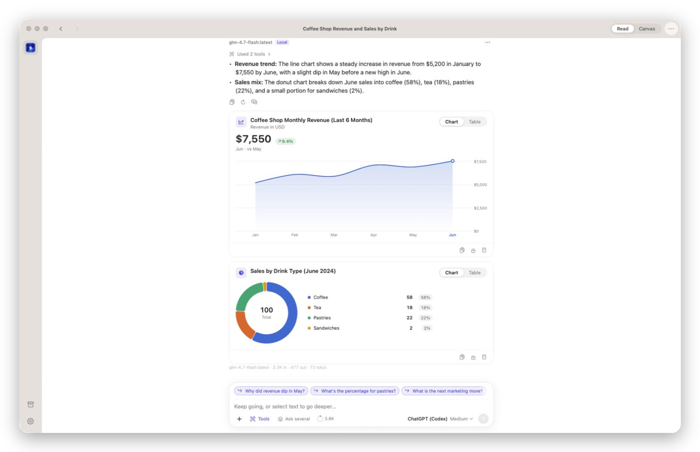
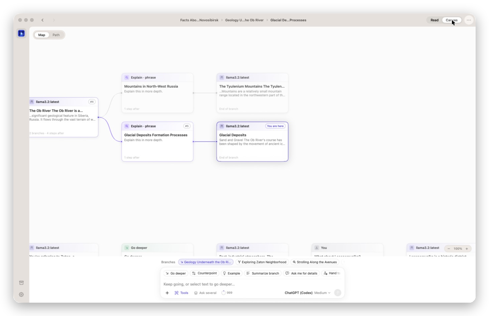
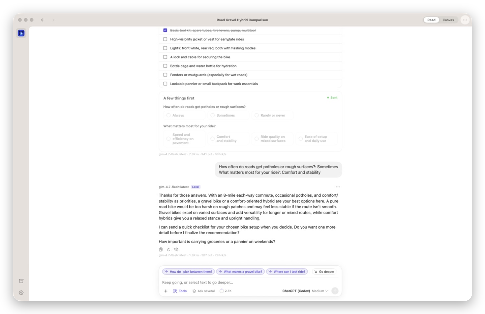
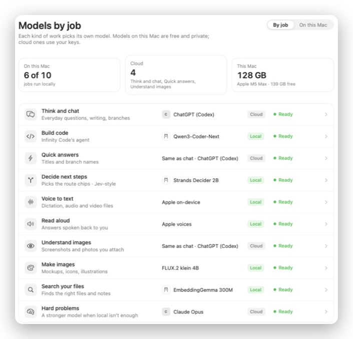
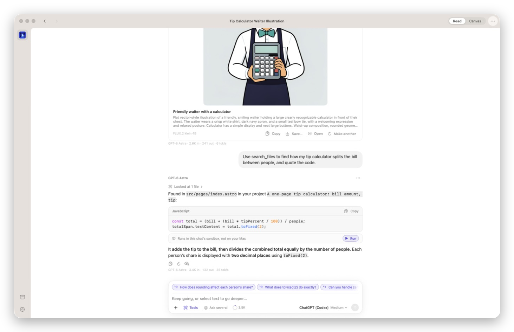

# Infinity

**A Mac app for going down rabbit holes.** 
Chat, build software and run assistants with any AI model: on your Mac, or with your own accounts.

<a href="https://github.com/InfinityChat/mac/releases/latest"><b>⬇&nbsp; Download for Mac</b></a>
&nbsp;·&nbsp; macOS 14 or newer &nbsp;·&nbsp; Apple silicon and Intel

  

 

## Every answer leads somewhere

Select any phrase in an answer to go deeper on it, or tap a route like **Go deeper**, **Counterpoint** or **Example**. Every side path stays on the canvas, so you can keep going and come back to any point later.

## Answers you can see, not just read

When a picture is clearer than prose, Infinity draws it: line, bar, donut, combo, scatter, range and timeline charts, tables, comparisons, checklists and quick questions. Every chart can switch to a table, be copied as an image, or be asked about.

## Any model, the right one for each job

Use free, private models on your Mac with **Ollama**, **LM Studio** or **Apple Intelligence**, or paste a key for **OpenAI**, **Anthropic**, **Google**, **OpenRouter** and others. Already use Codex? Your **ChatGPT plan** works too, no API key needed.

**Models by job** picks a model for each kind of work (chatting, coding, voice, images, searching your files) to suit your Mac, and downloads the local ones for you.

## Pictures, files and code

Make images on your Mac with FLUX.2 or Image Playground, or in the cloud. Ask questions about your own folders and Infinity finds the right file by meaning. Code runs in a sandbox, not on your Mac.

## Three apps in one

| | |
|---|---|
| **Chat** | Branching conversations, ask several models at once, projects, and ⌘K to jump anywhere. |
| **Code** | Describe an idea or open a folder. Every change becomes a save point you can go back to, with a live preview beside the thread. |
| **Assistant** | Assistants you chat with like contacts, with their own memory, folder and voice. Group chats, an inbox for approvals, schedules, and a morning brief. |

## Private by default

There's no Infinity account and no analytics. Chats, settings and the file index stay on your Mac; API keys live in your Keychain. When you use a cloud model, your message goes straight to the provider you chose, with your key. Read the [privacy note](PRIVACY.md).

 

## Install

1. [Download the latest `Infinity-x.y.z.dmg`](https://github.com/InfinityChat/mac/releases/latest).
2. Open it and drag **Infinity** into **Applications**.
3. Open Infinity and pick your models: free ones on your Mac, your own API keys, or both.

Infinity is signed and notarized by Apple. It checks for updates once a day and installs them for you.

## Feedback

Infinity is in early testing. Use **Help ▸ Send Feedback…** in the app, or email [support@ampdynamic.com](mailto:support@ampdynamic.com). Found a bug? [Open an issue](https://github.com/InfinityChat/mac/issues).

 

Made by Nik Kotov · Infinity and its icon are trademarks of Nik Kotov.

